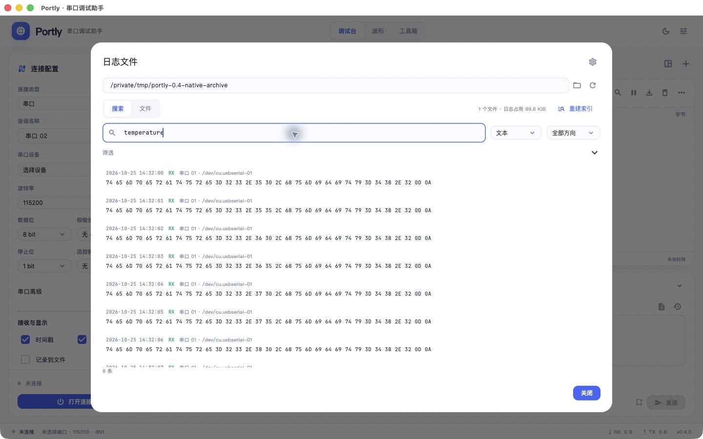
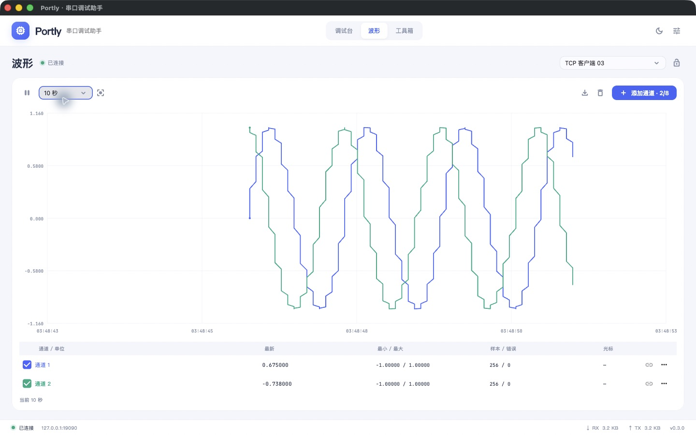
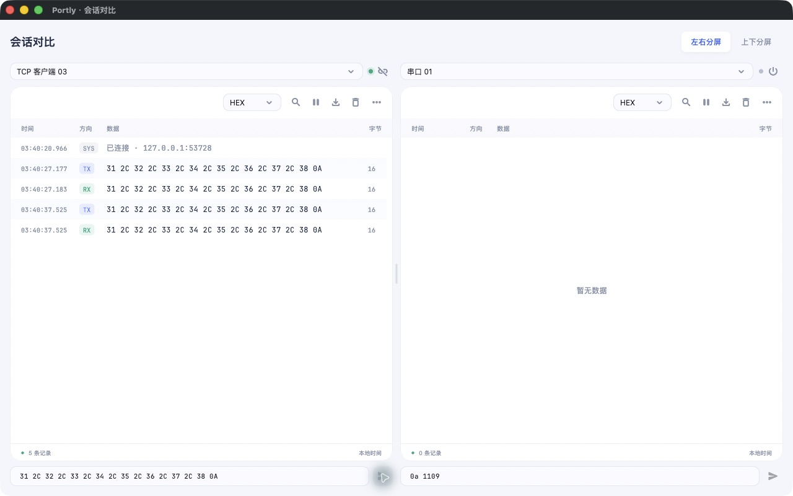
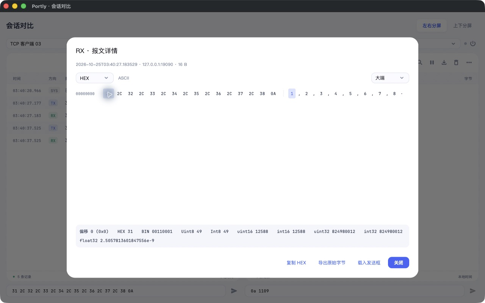

# Portly · 串口调试助手

Flutter / Dart 桌面应用，支持串口、TCP 客户端、TCP 服务端和 UDP。当前版本 **0.5.0**。

macOS M 系列安装包要求 macOS 13+，使用 DMG 拖入 Applications 或解压 ZIP。Windows x64 / ARM64 提供按架构生成的安装器与便携 ZIP；构建及安装校验由对应原生 GitHub Actions runner 执行。Linux 工程保留，尚无本次发行包。

源码采用 [Apache-2.0](LICENSE)；第三方许可证与 LGPL 对应源码见 [THIRD_PARTY_NOTICES.md](THIRD_PARTY_NOTICES.md)。

- [发行页面](https://github.com/IceBigPig/portly/releases)
- [原生构建与安装验证](https://github.com/IceBigPig/portly/actions/workflows/release.yml)
- [发布步骤及签名状态](docs/RELEASING.md)
- [本轮验证范围](docs/VALIDATION.md)

## 运行与构建

```sh
./tool/run-macos.sh
./tool/build-macos.sh
open build/macos/Build/Products/Release/Portly.app
```

本机环境：Flutter 3.47.7 / Dart 3.13.5、Xcode 27.1、CocoaPods 1.17.0。脚本使用工程局部 `DEVELOPER_DIR`，不修改系统设置。原生依赖可通过 `brew install cocoapods automake libtool` 安装。

## 0.5.0

- 发送与执行历史：独立SQLite表，固定保留最多1000条 / 32MiB编码正文，按会话和类型分页；保留主体及处理策略、最终字节、目标、命令revision/参数、步骤/循环、响应、耗时和结果。历史只载入草稿；final-only旧记录使用HEX Raw回填，避免重复CRC。
- 执行详情区分“已提交”和“已匹配响应”，设备异常、超时、停止、失败及重启中断分别记录；文件只存元信息/提交数量，长循环保留近期步骤和活跃摘要。详情支持按ID定位仍在内存的报文、复制保留字节和查看冻结的响应规则。
- 导入冲突按UUID处理，默认保留，支持逐项/全部生成副本或覆盖；组复制同步重建引用。先整批校验并预览，再检查库指纹，在后台生成一致备份并事务提交；失效预览、备份失败和提交失败均不部分写入。可导出当前组、选中或全部库。
- 导入期间阻止旧行编辑器提交；离屏无效输入仍保留，修正前不发送上次有效字节。覆盖同UUID后清理旧编辑状态；运行中的任务仍使用先前冻结快照。
- 配置库使用主写入者锁，阻止多个主实例互相覆盖；退出等待历史排空、关闭DB并释放锁后才允许重新打开。对比窗口仍代理到主窗口，不创建第二配置写入器。
- 日志索引schema3拆分HEX/文本/短token，去掉不需要的位置列表。候选分页读取并精确回读原文；升级前保留完整旧索引备份，容量不足时拒绝迁移。相同60秒Release校准中总归档占用从约859MB降到266MB，约减少69%。

长时间Release验证的机器、负载、原始计数、源码SHA、内存/帧时/CPU/磁盘口径见 [性能记录](docs/performance/README.md)。短校准不作为30分钟或2小时通过证明，最终结果以该记录为准。

## 0.4.0

- 文件日志改为后台 NDJSON 归档及 SQLite 索引。默认单文件 100 MiB、最多 20 份、归档总占用 2 GiB；总占用包含索引、管理文件及事务空间。达到数量或容量上限先停止记录，只有明确开启循环覆盖才清理本归档最早的已关闭文件，不处理目录中的其他文件。
- “记录到文件”旁及日志菜单增加文件搜索入口：文本 / HEX、会话、方向、时间范围、单文件筛选与分页，点击结果按文件偏移读取原报文，可使用原有字节查看器。索引损坏、文件缺失和末尾截断均有错误与恢复状态。
- 参数化命令使用 `{{name}}` 占位符，支持 uint8/int8/uint16/int16/uint32/int32、HEX 和文本，包含默认值、范围及字节序。发送、顺序执行、复制与载入前校验参数并预览最终字节；CRC 在参数代入后只附加一次。
- 响应规则支持 Modbus RTU、完整字节、字节前缀、按偏移掩码、文本精确 / 包含，以及明确不等待；字节 / 文本支持固定长度、分隔符和 UDP 数据报分帧。RTU 读取校验数量、写入校验回显、异常响应停止任务，避免把设备异常当作成功。
- 执行前冻结命令、revision、参数、规则及目标；TCP 客户端与 UDP 来源隔离，UDP 域名在一次任务中只解析一次，并与接收的数字地址匹配。超时、断线、停止均不重放请求。
- 行发送等待必要的配置保存，未修改时不写盘；并发发送共享一次待完成写入，保存失败阻止发送。会话切换不等待保存。未开启文件记录时不再为每个接收包生成日志 JSON / HEX。
- 进阶参数与响应设置折叠显示，默认命令库为空，不加入演示会话或数据。



## 0.3.0

- 串口自动重连：默认关闭，可设置间隔与次数；根据 USB 序列号/VID/PID 或蓝牙地址识别原设备。身份缺失或有多个匹配时停止自动打开；手动断开、关闭会话和取消打开均可终止重连。重连不恢复旧发送任务，重启也不自动连接。
- DTR / RTS 实时控制及 CTS / DSR 只读状态：在“串口高级”展开；RTS/CTS 流控占用 RTS 时禁止手动 RTS；失败不更新已生效状态，不可读取时显示“不可用”。
- 波特率：常用值菜单包含 4800、9600、19200、38400、57600、115200 等，支持正整数自定义值；驱动不支持时报错。
- 最多 8 通道波形：文本字段、固定帧长/字节偏移、关联读取请求的 Modbus 寄存器响应；通道名、单位、颜色、显示、启停、来源/前缀匹配、字节排列、比例与偏移独立配置并保存。
- 波形显示暂停时继续采集，隐藏不停止映射；解析失败、非有限数值、超时和断线留缺口；每通道最多 100000 个原始样本，全应用最多 250000 个。CSV 导出使用原始样本，光标可关联原报文，报文已淘汰时提示。
- 会话布局菜单支持左右/上下分屏，分隔条可拖动；支持独立原生对比窗口。各视图共用主窗口连接，独立暂停、搜索与显示格式；子窗口通过 IPC 代理发送/连接/停止操作，不再占用同一串口。
- HEX、文本、HEX + ASCII、二进制显示；双击报文打开偏移/字节/字符并排查看器，选中字节联动显示 BIN、整数与浮点解释，支持大小端及原始字节导出。
- 文件发送：在单条发送栏点击文件图标，按原始字节流式分块发送，可设块大小和间隔，有进度与停止入口；不自动附加 CRC、尾缀或重新编码，断线不续传。
- 切换会话同步生效；不因切换触发写盘，串口枚举改为共享缓存/后台刷新，波形页离开后不持续构建图表。
- 配置 JSON 与 SQLite 事务在后台 isolate 执行；编辑合并 2 秒保存，完全相同内容跳过写入，关闭应用时保存。界面移除常驻“保存中”文字，错误仍显示。
- 修复串口配置对象被提前释放、关闭时再次释放的问题；移除共享原生句柄的读取 isolate，改为有上限的非阻塞读取；关闭/取消读写使用连接代次校验，避免已释放句柄被继续使用。






## 数据与磁盘

SQLite配置表保存连接参数、发送草稿、命令库、工具草稿与界面配置；发送/执行历史使用独立表与有界后台队列。RX不会单独写入历史或配置，也不持久化波形样本。日志默认留在有上限的内存缓存。只有用户开启“记录到文件”才持续写 NDJSON 原始记录和检索索引。UI 只提交有界的原始字节队列（默认 10000 条 / 8 MiB）；每会话按 128 条 / 256 KiB 或 50 ms 提交后台，同目录再用最多 128 条 / 256 KiB、最长 50 ms 的有界批次合并，减少多个会话各自提交索引造成的写放大。原始文件同步和SQLite FULL事务提交后才确认批次，停止记录会等待已接受的队列完成。队列或磁盘不足时停止记录并提示未落盘条数，串口连接与有上限的内存日志继续工作。主动日志记录与导出会产生与数据量相关的磁盘写入和空间占用。

历史的32MiB限制只计算编码正文，不包括SQLite索引、WAL或空闲页；它控制留存量，不限制累计写入量。高频发送和循环任务仍会更新历史。崩溃、强杀或断电可能丢失尚在内存队列的更新；正常退出会先停止任务并排空已接受的写入，重启只将已经持久化的未完成任务标记为中断，不重新发送。实际磁盘写入应查看性能记录的内核计数，不能用文件净增长推断SSD寿命。

归档容量只统计 Portly 管理的日志、索引和相关事务/管理文件，不统计同目录其他文件。该容量是安全上限，不保证可填满：写入会预留索引增长和回滚事务空间，可能在显示占用尚未达到设定值时停止。开启多个会话记录到同一目录时共用索引写入与目录限制；不同录制任务不能同时采用冲突的限制。

主会话日志上限为每会话 20000 条 / 16 MiB，全局 100000 条 / 64 MiB。独立对比窗口保留每会话最多 4000 条 / 4 MiB 的显示缓存。内存淘汰不会删除已写日志文件。

## 既有功能

- 连接参数、TCP 监听和客户端定向发送、UDP 绑定及固定目标。
- 时间戳、搜索、暂停、详情、导出、文件记录、RX/TX 计数。
- 文本编码、尾缀、CRC 预览、单条/循环发送及停止。
- 命令分组、编辑排序、JSON 导入导出、顺序执行、RTU 响应匹配和超时停止。
- CRC、LRC/SUM/XOR、进制、HEX/文本、字节序与数值、Modbus RTU、NMEA、时间戳工具。

## 验证

```sh
dart analyze lib test
./tool/flutter.sh test
./tool/flutter.sh build web --release
```

自动化回归结果见 [验证记录](docs/VALIDATION.md)，覆盖串口重连生命周期/控制线、8 通道解析、流式文件发送及取消、数据恢复、无写盘会话切换、分屏与 900×600 / 1100×700 / 1440×900 布局。原生回环界面验证覆盖跨窗口代理发送及 3308 字节文件、两通道实际接收解析。

0.4.0 原生界面已验证文件索引载入、文本/HEX查询、重建与原报文读取；专项临时数据已清理。详细证据与边界见 [验证记录](docs/VALIDATION.md)。USB 适配器的真实电平和拔插，以及 Windows/Linux 设备矩阵尚未覆盖。长测按用户要求提前结束，没有30分钟或2小时通过结论。构建使用本地 ad-hoc 签名，未做 Developer ID 公证。

`docs/开发设计说明.md` 保存原始完整 V1 需求；其中的整体范围不等于当前已验收范围。

导入备份保存在本地数据库同目录，成功导入后提供路径。为保留用户可恢复的版本，不会自动删除旧导入或迁移备份；这些备份占用与日志归档额度分开，需按使用情况另行归档或清理。

升级启动前应退出旧版本。主写入者锁由0.5.0实例遵守，不能阻止旧版或外部SQLite工具绕过该锁修改数据库。

## 从源码分发

安装包、便携包与 `Portly-0.5.0-source.zip` 应在同一个 Release 页面提供。源码包包含应用完整源码、资源、锁文件、平台工程、构建脚本及 LGPL 对应源码，支持修改后完整重建。CI 首先验证版本、各架构二进制与哈希，再运行 Windows 安装/启动/安全退出/卸载检查；main 推送与版本标签仅建立或更新草稿 Release，发布者检查附件后再公开。详见 [RELEASING.md](docs/RELEASING.md)。
