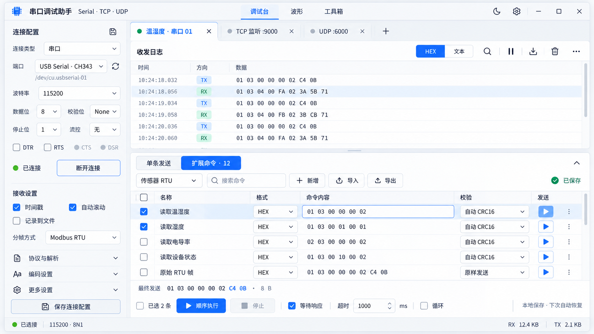

# 跨平台串口与网络调试助手开发设计说明

| 文档项 | 内容 |
|---|---|
| 版本 | v1.0 |
| 日期 | 2026-10-25 |
| 目标平台 | macOS、Windows、Linux 桌面 |
| 建议技术栈 | Flutter / Dart；平台串口适配层；Dart 网络 I/O；本地 SQLite |
| 文档状态 | 待实现的产品与开发规范，供界面开发、通信开发和测试使用 |
| 交付内容 | 信息架构、页面规格、交互规则、数据契约、算法向量、开发顺序和验收要求 |

> **本说明描述拟开发产品，不代表已有应用或功能已经实现。**图片用于表达视觉、排版和操作入口；字段、状态、协议规则和黄金测试向量以本文为准。图片内的示例地址、HEX 数据、CRC 数值及按钮状态不得直接作为实现或测试依据。性能数值均为待实测的验收目标。

## 阅读导航

- [1. 产品目标与版本范围](#1-产品目标与版本范围)
- [2. 视觉体系与窗口布局](#2-视觉体系与窗口布局)
- [3. 信息架构与页面编号](#3-信息架构与页面编号)
- [4. P01 调试台](#4-p01-调试台)
- [5. 单条发送、扩展命令与执行](#5-单条发送扩展命令与执行)
- [6. P02 波形](#6-p02-波形)
- [7. P03 工具箱与八项工具](#7-p03-工具箱与八项工具)
- [8. 辅助抽屉与对话框](#8-辅助抽屉与对话框)
- [9. 数据模型、存储与导入导出](#9-数据模型存储与导入导出)
- [10. Flutter 分层实现与数据流](#10-flutter-分层实现与数据流)
- [11. 异常处理规范](#11-异常处理规范)
- [12. Release 性能与平台验收目标](#12-release-性能与平台验收目标)
- [13. 建议开发顺序与阶段产物](#13-建议开发顺序与阶段产物)
- [14. 可执行验收清单](#14-可执行验收清单)
- [15. 一手参考资料](#15-一手参考资料)

### 设计图索引

| 文件 | 对应内容 |
|---|---|
| [01_debug_workspace.png](images/01_debug_workspace.png) | 调试台、串口参数、收发日志、底部扩展命令表 |
| [02_network_modes.png](images/02_network_modes.png) | TCP 客户端、TCP 服务端、UDP 的配置与发送目标 |
| [03_toolbox_crc.png](images/03_toolbox_crc.png) | CRC-16/MODBUS 计算、完整帧验证与结果复用 |
| [04_toolbox_radix.png](images/04_toolbox_radix.png) | 进制、位宽、符号解释、大小端字节表示 |

解压交付包后保留本文件与 `images` 文件夹的相对位置，即可在支持 Markdown 的编辑器中查看图片。建议开发先读第 3 章页面清单，再按第 13 章顺序实施，并逐项完成第 14 章验收。

## 1. 产品目标与版本范围

### 1.1 产品定位

面向嵌入式、传感器、设备联调和工业通信场景的轻量桌面调试工具。用户能够在一个窗口中连接串口或网络设备、观察原始数据、发送临时命令、保存大量常用 RTU 指令，并通过离线工具核对校验、进制、字节序、报文和时间。

主流程固定为：**创建会话 → 配置并打开通信 → 查看数据 → 发送或执行保存命令 → 解析、计算或导出**。跨平台保持相同信息结构和操作语义，窗口装饰及快捷键遵循各系统习惯。

“轻巧”落实到两方面：视觉上以日志、输入和常用操作为中心，较少使用装饰、大卡片及永久侧面板；实现上使用有界缓存、按需渲染、可控发送队列和按需加载的功能模块。安装包、内存和 CPU 占用以发行构建实测，不因选择 Flutter 就预先承诺固定数值。

### 1.2 V1 必做范围

| 优先级 | 功能范围 | 完成定义 |
|---|---|---|
| V1 必做 | 三平台桌面发行 | macOS、Windows、Linux 均有可安装或可运行的发行包，并通过本说明约定的设备与网络验证 |
| V1 必做 | 四种通信模式 | 串口、TCP 客户端、TCP 服务端监听、UDP 本地绑定及收发；可同时存在多个会话 |
| V1 必做 | 数据收发工作台 | HEX／文本、时间戳、方向和端点、搜索、暂停显示、清空、导出、文件记录及统计 |
| V1 必做 | 单条与循环发送 | 内容编辑、格式和编码、最终字节预览、校验、目标选择、发送历史、循环及停止 |
| V1 必做 | 扩展命令与持久命令组 | 新增、编辑、保存、分组、排序、搜索、单条发送、选中顺序执行、导入导出；退出后仍保留 |
| V1 必做 | 三个主页面 | 调试台、波形、工具箱；切换页面保留工作上下文且不关闭连接 |
| V1 必做 | 八项工具 | CRC；LRC／SUM／XOR；进制转换；HEX／文本；字节序与数值；Modbus RTU；NMEA XOR；时间戳 |
| V1 必做 | 配置与恢复 | 连接配置、会话布局、命令库、工具草稿、迁移与备份；恢复不自动连接或发送 |
| V1 必做 | 异常与边界处理 | 无效输入、权限、设备拔出、断线、目标失效、超时、存储失败和缓存上限有准确反馈 |
| 后续增强 | 大型扩展能力 | 任意用户脚本、插件市场、云同步、远程共享、频谱分析、独立多窗口、复杂协议仿真 |

CRC、进制转换、网络连接及扩展命令均属于 V1，不能以“预留入口”替代可用功能。后续增强不阻塞首版主流程，也不在首版界面中展示无响应的功能按钮。

### 1.3 统一默认规则

- 新会话默认类型为串口，参数为 115200、8 数据位、无校验、1 停止位、无流控；创建后不自动打开。
- 网络模式中，TCP 客户端默认端口 9000，TCP 服务端默认本地端口 9000，UDP 默认本地端口 9001；地址为空或仅作占位提示，必须由用户确定实际目标。
- 所有自动重连、循环发送、自动重试默认关闭。RTU 批量默认等待匹配响应，超时 1000 ms，超时停止；单条循环周期和批量步骤延时分别默认 1000 ms，可配置。
- 保存命令、载入发送框、恢复配置、切换页签及工具计算均不隐含发送操作。
- 发往哪个会话、哪个 TCP 客户端或 UDP 端点必须可见。日志筛选不改变发送目标。
- 整体使用一个主窗口和多个会话页签；抽屉与对话框用于管理，不创建第二套独立通信状态。

## 2. 视觉体系与窗口布局

### 2.1 视觉方向

使用适合桌面的紧凑 Material 3 风格：浅灰应用背景、白色工作表面、少量蓝色强调、细分隔线、小圆角、清楚的键盘焦点。使用 Flutter Material 组件并统一主题，不直接沿用面向手机的大按钮、大间距和超大圆角。

标题、状态、数据与操作形成清晰层级。HEX 和协议字节使用等宽字体；中文标签使用各平台可用的清晰无衬线字体。RX、TX、错误及连接状态同时使用文字或图标，不能仅靠颜色判断。

### 2.2 建议设计 tokens

| Token | 浅色建议 | 深色建议／说明 |
|---|---|---|
| `color.background` | `#F5F7FB` | `#151A21` |
| `color.surface` | `#FFFFFF` | `#1C2430` |
| `color.surfaceMuted` | `#F0F3F8` | `#242F3D` |
| `color.border` | `#DDE3ED` | `#344154` |
| `color.textPrimary` | `#263447` | `#E8EEF8` |
| `color.textSecondary` | `#65758A` | `#A7B5C8` |
| `color.primary` | `#2864DC` | `#8EBCFF` |
| `color.primaryContainer` | `#E7EFFE` | `#243F66` |
| `color.success` | `#218A57` | `#6BCD97` |
| `color.warning` / `color.error` | `#A96A10` / `#C23C45` | 使用适配深色表面的对应浅色，不照搬深色文字色值 |
| 圆角 | 输入与按钮 6；面板 8；对话框 12 | 会话页签与分段选择保持同一圆角体系 |
| 间距 | 4、8、12、16、24 | 主要使用 8 和 12；避免在紧凑表格中放 24 以上空隙 |
| 描边与焦点 | 普通分隔线 1；焦点外框 2 | 焦点不能只用轻微背景变化表示 |
| 字号 | 正文 13–14；辅助 12；分区标题 14–16；页面标题 18 | 等宽日志初始 13，可调 11–18；不通过缩小全局字体适应小窗口 |
| 控件高度 | 紧凑输入／按钮 32–36；常规 36–40 | 小图标可视尺寸 16–18，点击区域至少 28–32 |
| 表格行高 | 日志 28–32；命令 36–40 | 内容过长用展开、横向滚动或详情，不强行挤成多行高卡片 |

以上数值为开发初始主题参数，可配置项集中管理。不得每个页面各自定义主色、按钮圆角和字号。深色模式必须逐页检查边框、选择状态、禁用态、曲线及错误信息的可读性。

### 2.3 尺寸与响应式回退

推荐初始窗口为 1440×900 逻辑像素，最小支持 900×600；设计参考图可以使用 1920×1080 比例。首次启动将窗口限制在当前屏幕可见范围内；恢复失效的外接屏位置时回到主屏。

| 窗口区间 | 调试台 | 工具箱与管理容器 |
|---|---|---|
| 宽度 ≥1280 | 左配置栏 260–300；中央日志；下方单条／扩展命令 dock；最多两列常驻内容 | 工具分类 180–220，详情区可将输入和结果并排；管理使用抽屉或对话框 |
| 宽度 1000–1279 | 左栏约 240；高级配置折叠；命令内容允许横向滚动 | 工具输入和结果优先上下排列 |
| 宽度 900–999 | 连接配置变为覆盖式抽屉；顶栏保留连接摘要；日志占满宽度 | 分类使用下拉或紧凑顶部选择；管理容器接近全宽 |
| 高度 <680 | 减小底部 dock；提供“专注日志／专注命令”；停止任务入口始终可见 | 表单内部滚动，保存／取消固定在容器底部 |

扩展命令展开后初始占主工作区约 40%，允许拖动高度；单条发送初始约 180–220。隐藏面板只改变布局，不能停止队列或清空输入。窄窗口命令行简化为“名称＋内容摘要＋发送”，完整编辑进入对话框。

### 2.4 视觉稿与开发差异

四张 PNG 的实际尺寸均为 1672×941，作为视觉参考使用；应用尺寸采用 Flutter 逻辑像素和前述响应式规则，不按 PNG 物理像素硬编码。

工具箱右上角的当前会话状态须与底部状态栏来自同一状态源；已连接显示绿点，未连接／已关闭显示灰点。图中可能出现的右上灰点与底部已连接状态不一致，属于渲染细节，开发时必须统一。

CRC 图中“RTU 发送字节”表达的是两个 CRC 字节。实际控件标题统一为**“CRC 发送字节（低字节在前）”**，完整报文在独立区域显示，不能把两个 CRC 字节标成完整 RTU 帧。

进制图展示 unsigned32 的常用状态。实际页面必须提供“数值／位模式”输入语义以及“有符号／无符号、32／64 位”切换；可将解释方式放入清楚可见的高级区。不得将十六进制 `FFFFFFFF` 在没有语义提示时同时当作正数和负数。

## 3. 信息架构与页面编号

| ID | 页面／容器 | 主要用途与入口 |
|---|---|---|
| P01 | 调试台 | 默认首页；连接配置、收发日志、单条发送和扩展命令 |
| P02 | 波形 | 从当前会话提取数值并绘制时间序列；顶部主导航进入 |
| P03 | 工具箱 | 校验、转换、报文和时间四类工具；顶部主导航进入 |
| T01 | CRC 校验 | CRC-16/MODBUS 计算与完整帧校验 |
| T02 | LRC／SUM／XOR | Modbus ASCII LRC、SUM8、XOR8 计算与验证 |
| T03 | 进制转换 | 二、八、十、十六进制；32／64 位；有符号／无符号 |
| T04 | HEX 与文本 | 字节与文本转换、编码和不可见字符检查 |
| T05 | 字节序与数值解析 | 整数、IEEE 754、字节排列及原始位模式 |
| T06 | Modbus RTU 生成与解析 | 常用功能码请求生成、请求／响应／异常解析 |
| T07 | NMEA XOR／校验 | `$`／`!` 语句生成校验与逐行验证 |
| T08 | 时间戳转换 | Unix 秒／毫秒、UTC、命名时区和日期时间 |
| D01 | 命令库管理抽屉 | 扩展命令“管理”；分组、排序、移动、导入导出 |
| D02 | 命令编辑对话框 | 新增及完整高级编辑；内容、格式、校验和响应规则 |
| D03 | 连接配置管理 | 左栏配置选择器；保存、复制、重命名及导入导出 |
| D04 | 新建会话 | 会话页签“＋”；选择类型、名称或已有配置 |
| D05 | 报文解析详情 | 日志行双击／解析；显示原始字节和字段解释 |
| D06 | 日志导出与文件记录 | 日志工具栏／文件记录设置；选择范围、格式和目录 |
| D07 | 应用设置 | 顶部齿轮；外观、日志、默认行为、快捷键及数据管理 |
| D08 | 历史／执行详情 | 发送历史及批量进度；回填、查看结果和定位日志 |

“调试台／波形／工具箱”为唯一主导航。会话条属于通信上下文，不再用“收发日志／波形／工具”重复建立第二套主导航。命令库属于应用级数据；当前命令组、勾选、草稿和任务属于具体会话。

## 4. P01 调试台

### 4.1 主界面参考



图 1：调试台视觉参考。开发实现以本文字段、状态和发送规则为准；命令库使用底部可展开面板及独立管理抽屉。

### 4.2 区域与控件

| 区域 | 字段／控件 | 行为与状态 |
|---|---|---|
| 顶部应用栏 | 名称、三主导航、主题按钮、设置 | 切换主页面不改变连接；有运行任务时显示低干扰状态入口 |
| 会话条 | 名称、模式图标、状态点及文字、关闭、＋ | 按稳定 ID 管理；可重命名；活动任务关闭时明确“停止并关闭” |
| 左栏连接区 | 配置选择／保存、连接类型、对应参数、打开或监听按钮 | 模式表单随类型切换；活动连接须先断开或另建会话，不能静默改变类型 |
| 左栏显示与解析区 | 时间戳、自动滚动、记录到文件、编码、分帧和协议 | 常用项展开，高级项折叠且显示摘要；显示配置不改写原始字节 |
| 日志工具栏 | HEX／文本、搜索、暂停显示、导出、清空、更多 | 暂停时显示新增数量；清空缓存、清零计数及删除文件相互独立 |
| 日志区 | 时间、TX／RX／系统事件、端点、数据 | 虚拟滚动；选择、复制、详情、载入工具；网络模式显示来源／目的 |
| 底部 dock | 单条发送／扩展命令、拖动分隔、展开／收起 | 两种编辑模式互斥显示，切换保留内容；运行摘要和停止入口可见 |
| 底部状态栏 | 当前会话摘要、RX/TX 字节、记录状态、任务摘要 | 只统计当前会话；点击任务摘要进入 D08 |

### 4.3 日志行为

原始记录保留字节、方向、时间、端点、运行会话及序号。文本、HEX、协议字段均为原始数据的视图。系统事件单独存储，不能把“连接成功”文字写入 RX 字节流。

时间默认显示本地 `HH:mm:ss.SSS`，详情与导出保存完整时间及 UTC 偏移。持续时间和超时使用单调时间来源，不因系统时钟被校正而倒退。相同时间戳按会话内递增序号排序。

用户向上滚动时暂挂自动跟随，出现“回到最新 · 新增 N 条”。暂停显示仍采集、更新计数并继续已启用的文件记录；恢复时显示最新缓存，不保证暂停期间的全部历史仍常驻内存。达到缓存上限须显示淘汰提示，历史以已启用的文件记录为准。

搜索默认匹配当前显示文本，HEX 模式支持字节序列搜索；二者不能混淆。选择报文后可复制显示文本、复制原始 HEX、打开 D05，或送往指定工具。日志筛选、行选择及搜索绝不改变发送目标。

文本解码显示异常时允许替代字符，并保留原始字节；向发送区或工具转移字节时使用原始内容，不能从带替代字符的显示文本反向构造。清空视图仅清当前会话内存记录，不删除文件、命令库或统计；另设“重置统计”。

### 4.4 四种连接的配置与状态


图 2：三种网络模式的并列说明板，用于比较不同字段。**实际应用根据选中的连接类型切换左栏配置，不将三个大型配置区同时放在首页。**

#### 4.4.1 串口

| 字段／控件 | 默认／规则 | 状态行为 |
|---|---|---|
| 设备 | 下拉列出友好名和系统路径，旁置刷新 | 无设备显示空状态；保存标识不代表下次同一路径仍是同一设备 |
| 波特率 | 115200，可输入合法自定义值 | 底层不支持时报告参数错误，不自动换成其他速率 |
| 数据格式 | 8 数据位、无校验、1 停止位 | 常用摘要为 8N1；完整参数可在高级区修改 |
| 流控 | 无 | 支持能力来自所选适配器；不能显示未实际生效的控制状态 |
| DTR／RTS | 手动控制为高级项 | 硬件流控占用 RTS 时禁用冲突的手动操作；不支持则说明 |
| CTS／DSR | 只读指示 | 底层无法获取时显示“不支持／不可用”，不伪造低电平 |
| 操作 | 打开串口／断开 | 打开期间可取消；活动状态关键参数只读，修改需断开 |

状态迁移：未打开 → 打开中 → 已打开 → 关闭中 → 已关闭。打开失败进入错误；设备移除使当前实例失效，取消未开始的发送任务并保留配置与日志。重新枚举后由用户选择或确认原设备，不自动切换到名称相似的端口。

#### 4.4.2 TCP 客户端

| 字段／控件 | 默认／规则 | 状态行为 |
|---|---|---|
| 名称 | 可编辑 | 仅显示用途，不代替端点 |
| 服务器地址 | 域名或 IP；默认空 | 就地验证；实际建立的远端地址在状态摘要显示 |
| 服务器端口 | 9000；范围 1–65535 | 不能用 0 作为远端端口 |
| 连接超时 | 5000 ms；可配 100–60000 ms | 超时进入失败状态并提供重试 |
| 自动重连 | 默认关闭 | 开启后默认间隔 2000 ms、最多 10 次，可配；手动断开立即取消计时 |
| 本地绑定 | 高级项；默认系统选择 | 需要指定网卡时填写；错误必须定位到本地绑定 |
| 操作 | 连接／取消／断开 | 已连接时目标参数只读；修改可另建会话 |

状态迁移：未连接 → 解析／连接中 → 已连接 → 断开中 → 已断开。连接失败可重试；意外断开且已启用重连时进入等待重连，再发起新连接。每次连接成功产生新的运行代次。重连不自动重发上一条命令，不恢复中断的循环或批量任务。

#### 4.4.3 TCP 服务端

| 字段／控件 | 默认／规则 | 状态行为 |
|---|---|---|
| 本地绑定地址 | 默认全部 IPv4 接口 `0.0.0.0`；可选具体网卡 | 通配地址与设备实际可访问的地址分别显示 |
| 监听端口 | 9000；范围 1–65535 | 被占用或权限不足时不得显示监听成功 |
| 监听按钮 | 开始监听／停止监听 | 监听与客户端数量分别显示；无客户端也可处于监听中 |
| 客户端列表 | 连接 ID、IP:端口、接入时间、状态、断开 | 每次接入分配新 ID；单个断开不影响其他客户端 |
| 发送目标 | 单个客户端／主动选择全部客户端 | 默认无目标；首个客户端到来后可突出显示但不默发；无在线目标时禁用发送 |
| 日志过滤 | 全部／某客户端 | 仅影响显示，不改变发送目标 |

状态迁移：未监听 → 绑定中 → 监听中 → 停止中 → 已停止；失败进入绑定错误。各子连接另有在线、关闭中、已关闭状态。

V1“停止监听”统一表示停止接入、关闭本会话全部客户端、取消待发送任务并清除目标。存在客户端或任务时说明影响；不提供同名的“只停止接入但保留子连接”隐式行为。对单个客户端的断开操作使用明确图标及提示，不用含义为“删除历史”的垃圾桶代替。

对“全部客户端”的一次发送或批量执行，在提交时冻结在线目标集合；新加入客户端不自动加入已运行任务。不同客户端的响应和超时独立处理，不能用 A 的响应完成 B 的步骤。

#### 4.4.4 UDP

| 字段／控件 | 默认／规则 | 状态行为 |
|---|---|---|
| 本地地址／端口 | `0.0.0.0:9001`；本地端口可选 0，由系统分配 | 绑定完成后显示实际端口，不能继续把 0 当成可访问端口 |
| 操作 | 开始监听／停止监听 | 内部语义为绑定／关闭 socket；绑定后才能发送 |
| 目标地址／端口 | 默认空；端口 1–65535 | 发送区保持可见；本地端口和远端端口不能互相覆盖 |
| 最近来源 | 来源 IP:端口、最后接收时间、“设为目标” | 收到新报文只更新列表，点击后才改变发送目的地 |
| 广播 | 默认关闭；高级开关 | 开启后允许指定广播目标，仍须显示实际目的地址 |
| 组播 | V1 可隐藏，后续增强 | 未实现则不显示空按钮；不影响基本 UDP 收发验收 |

状态迁移：未绑定 → 绑定中 → 已绑定／接收中 → 关闭中 → 已关闭；失败为绑定错误。UDP 不使用“TCP 已连接”语义，不以发送成功推断远端在线或已收到数据。每个数据报独立记录来源和边界；停止监听关闭该 socket，也停止该会话发送任务。

### 4.5 生命周期共同规则

持久配置 ID、会话页签 ID、每次打开的运行实例 ID、TCP 子连接 ID 分开管理。异步事件和队列项携带运行实例 ID；旧实例的迟到回调不得修改新连接。重连后即使 IP:端口相同，也不能恢复旧子连接身份。

切换主页面、页签或打开管理抽屉不会断开。关闭会话顺序为：停止任务 → 取消未开始的队列项 → 解除订阅 → 关闭资源 → 完成状态更新。已提交的字节无法撤回，界面不显示“撤回设备操作”。

## 5. 单条发送、扩展命令与执行

### 5.1 单条发送面板

| 区域 | 字段／按钮 | 规则 |
|---|---|---|
| 目标行 | 当前会话和端点；TCP 子连接选择；UDP 目标 | 目标明确可见；离线或无效时禁止发送并提示 |
| 编辑行 | HEX／文本、等宽编辑框、编码、历史 | 形成独立草稿；格式切换尽量保持相同字节，不能无损转换时保留输入并提示 |
| 处理行 | 原样／自动 CRC、文本尾缀、最终预览、长度 | 编码、尾缀和校验只应用一次；自动 Modbus CRC 仅用于明确定义的二进制主体 |
| 操作行 | 发送、保存为命令、循环、周期、停止 | 空输入、非法 HEX、无目标或通道未就绪时禁止发送 |
| 反馈行 | 提交时间、字节数、响应／超时、任务状态 | 传输层接受与设备响应分别显示，不能把本地提交称为设备执行成功 |

文本编码 V1 支持 UTF-8、ASCII、UTF-16LE、UTF-16BE。ASCII 非 ASCII 字符及无法无损编码的输入报错；不以替代字符悄悄发送。文本尾缀为无、LF、CRLF、自定义字节，默认无。原样 HEX 可直接包含任意尾部字节，不额外套用文本换行。

发送快捷键仅在发送编辑框获得焦点且目标有效时工作：macOS 为 `⌘ Enter`，Windows／Linux 为 `Ctrl Enter`。普通 Enter 用于编辑。工具箱、搜索和命令命名框中的同组合键不得触发设备发送。

循环周期 `periodMs` 默认 1000 ms，可配置 10–86400000 ms，表示同一循环任务相邻两次实际提交之间的最小周期；实际还需满足队列、协议响应和链路速率。上一条未完成时不启动重叠请求，也不累计补发错过的周期。桌面定时器不承诺硬实时精度。

发送历史保存原始主体、格式、编码、尾缀与校验策略，同时保存实际最终字节和目标摘要。回填时主体和处理策略必须一并恢复；历史若只有最终字节，回填必须切换为 HEX 原样发送，防止再次追加 CRC。点击历史只载入草稿。

### 5.2 扩展命令面板

入口位于底部 dock 的“扩展命令 · N”分段。面板包括分组选择、搜索、新增、导入、导出、管理命令库、保存状态；下方为命令表格与执行工具栏。

| 表格列／区域 | 内容 | 交互 |
|---|---|---|
| 勾选 | 本次批量选择 | 选择归当前会话；不改变全局命令数据 |
| 名称 | 用户自定义名称和可选标签 | 点击名称输入框进入行内编辑；不自动载入或发送 |
| 格式／内容 | HEX／文本下拉、可编辑正文 | 下拉直接调整格式；正文支持行内编辑及横向查看；转换失败保留原内容并提示 |
| 校验 | 原样／自动 CRC16-Modbus 下拉 | 直接调整策略，重新计算预览；不依赖全局隐藏开关 |
| 发送／更多 | 单条发送、载入单条发送、高级编辑、复制、移动、删除 | 行尾发送使用当前会话目标；载入是独立动作，只填草稿 |
| 选中预览 | 最终帧、校验字节、长度、目标 | 预览和实际提交一致；附加字节使用轻量强调 |
| 执行栏 | 已选 N 条、顺序执行、停止、等待响应、超时、循环周期、步骤延时 | 开始时冻结顺序和目标；运行中编辑不会改变本次执行 |

搜索匹配名称、标签和正文，不改变保存的顺序。批量默认按当前组排序执行；跨组选择首版不支持，界面明确当前组。拖动排序后，下次任务按新顺序；进行中的任务维持快照。

点击行空白处或复选框仅选中并更新预览。名称、正文支持行内编辑，格式与校验下拉可直接调整；有效编辑在 Enter 或失焦时提交保存，Enter 不触发发送。非法内容保留并定位错误，该行发送及包含该行的批量执行禁用，不能把上一次有效内容当作用户本次输入发送。

D02 用于新增命令及完整高级设置。支持“保存为命令”将当前发送草稿命名并选组，用户无需再次输入报文。行内修改显示修改中、保存中、已保存或保存失败；只有持久化成功才显示已保存。行尾发送等待当前保存完成再生成命令快照；保存失败可重试，或通过独立的“载入单条发送”将有效内容交给临时草稿处理。

### 5.3 命令数据模型

| 字段 | 类型／默认 | 说明 |
|---|---|---|
| `id` / `groupId` | UUID 字符串 | 稳定引用；分组改名不改变关联 |
| `name` | 必填字符串，1–80 字符 | 同组允许重名但新增时提示；不能以名称作为主键 |
| `format` | `hex` / `text` | 决定正文解析规则 |
| `bodyHex` / `bodyText` | 二选一 | HEX 保存规范化主体，文本保存原字符；不同时维护两份可写真值 |
| `encoding` | 文本默认 `utf-8` | HEX 模式不参与编码 |
| `suffixHex` | 默认空 | 仅用于明确的文本尾缀；自动 RTU CRC 模式禁用 |
| `checksumMode` | `raw` / `modbus_crc16` | raw 原样发送；自动模式正文不含 CRC |
| `parameters` | 默认空数组 | 可选站号、地址等参数定义；每项有名称、类型、范围和默认值；任意脚本不在 V1 |
| `responseRule` | 默认无；RTU 可选匹配规则 | 地址、功能码、预期长度／关键字段；写操作匹配回显 |
| `timeoutMs` | 默认 1000 | 10–600000，可配；不默认重试 |
| `stepDelayMs` | 默认 1000 | 批量执行中，上一条完成或异常策略处理结束后，到下一条提交前的最小延时；10–86400000，可配 |
| `sortOrder` / `tags` / `note` | 排序整数／数组／字符串 | 搜索和管理用途 |
| `revision` / 时间字段 | 递增版本／UTC 时间 | 编辑成功后递增，供发送追溯 |

单条模板不永久绑定 TCP 临时子连接 ID。若用户希望命令关联某个连接配置，保存持久配置 ID 作为推荐项，实际执行仍以当前会话和可见目标为准。删除命令不会撤回已提交任务；删除前明确其是否被保存的执行序列引用。

### 5.4 最终字节构建与一次性校验

构建顺序为：解析输入或代入参数 → 按编码生成字节 → 附加明确文本尾缀 → 按选定策略追加校验 → 生成不可变预览。自动 RTU CRC 模式不叠加文本尾缀。

原样模式完整保留输入，包括已有 CRC 或故意错误的校验，适合协议负向测试；如检测到不一致，只作提示，不擅自修改。自动模式只保存不含 CRC 的主体，每次从主体生成最终缓存，传输层与循环任务不再添加任何校验。

导入完整 RTU 帧时，可提示两种选择：“完整帧原样保存”或“明确去掉末尾 CRC 后自动追加”。不能因为末尾碰巧满足 CRC 就擅自截断。

发送快照至少包含任务 ID、命令 ID／版本、会话 ID／运行实例、目标集合、最终字节、长度、响应规则、`timeoutMs`、任务的 `periodMs` 和步骤的 `stepDelayMs`。改变草稿、站号、校验或目标后立即使旧预览失效并重新构建；已排队快照不随编辑改变。

### 5.5 队列、响应与停止

每个会话有一个调度入口；TCP 服务端按子连接再隔离队列。手工发送、扩展命令、循环和批量均通过该入口，不能由不同定时器直接写底层句柄。队列初始上限为每目标 1000 项，达到上限拒绝新任务并说明。

RTU 请求／响应模式下，同一串口总线默认最多一个未完成请求。批量等待时，手工发送可明确加入队列，不能插入半帧或越过当前等待。无响应的主动上报及错误帧仍进入日志，但不自动推进任务。

匹配正常响应时，响应功能码须等于请求功能码；匹配异常响应时，功能码须等于“请求功能码按位或 `0x80`”。异常帧在来源、CRC、站址及长度合法后进入“设备异常”，不能先被普通功能码相等检查丢弃，再误报超时。读寄存器还应核对响应字节数与请求数量，写操作核对协议规定的回显字段。

批量步骤使用 `stepDelayMs`，从前一条完成或异常策略处理结束开始计时；循环使用 `periodMs`，从上一轮首条实际提交到下一轮首条提交计时。前一轮未结束时不重叠下一轮，不补发错过的周期。界面分别命名“步骤延时”和“循环周期”，不再用一个含糊的“间隔”字段表达两种含义。

| 任务状态 | 判定与反馈 |
|---|---|
| 排队 | 已冻结但尚未提交；可取消 |
| 提交中／已提交 | 按实际写入字节推进；短写继续处理或失败；不等于设备已处理 |
| 等待响应 | 仅在规则要求时等待；来源、CRC、地址、功能码和关键字段必须匹配 |
| 完成 | 原始发送已提交，或要求的有效正常响应已收到；界面标明依据 |
| 设备异常 | 收到有效 Modbus 异常响应；不是成功读取；默认停止本序列 |
| 超时／失败 | 无匹配响应、目标失效或传输错误；默认停止，不重放旧任务 |
| 已停止／取消 | 不再提交后续字节；已在链路上的数据不可撤回 |

RTU 无通用事务 ID，连续相同请求的迟到响应可能无法完全区分。默认超时停止，由用户决定继续，避免把迟到响应错误归到下一条。自动重试默认关闭，尤其不能假定写操作重复执行没有副作用。

Modbus RTU／串行从站地址 0 为协议广播，生成器只允许适用的写命令，不等待响应。标准 Modbus TCP 的 MBAP Unit ID 0 不能笼统当作串行广播，应服从具体设备或网关配置。TCP“全部客户端”是端点集合，不是协议广播。目标掉线后停止该目标的任务，不转发给另一个或后来占用同地址的新连接。

## 6. P02 波形

### 6.1 区域与操作

| 区域 | 字段／按钮 | 规则 |
|---|---|---|
| 上下文栏 | 数据源会话、连接状态、固定数据源开关 | 默认跟随当前会话；固定后显示锁定标签，切换调试台会话不改变来源 |
| 映射区 | 解析模板、字段／通道列表、名称、单位、颜色、显示开关 | 明确从哪些原始数据提取数值；不把任意 HEX 自动解释为温度或压力 |
| 图表工具栏 | 暂停绘图、时间窗、跟随最新、复位、导出 | 暂停绘图仅冻结视图；采集和映射继续，恢复回到最新窗口 |
| 主图区 | 时间轴、数值轴、图例、光标、选定样本 | 默认时间窗 60 秒，可选 10 秒／60 秒／5 分钟／自定义 |
| 摘要区 | 最新值、最小值、最大值、有效样本数、错误数 | 统计范围明确为当前时间窗；无数据显示“—” |
| 关联入口 | 查看对应报文、编辑映射 | 跳转 P01 并定位原记录；缓存已淘汰时显示文件定位信息或说明 |

### 6.2 数值映射契约

V1 提供三种无需脚本的映射来源：文本分隔字段、固定字节偏移、已支持的 Modbus 寄存器响应。每个映射保存会话配置引用、报文匹配条件、字段位置、数据类型、字节排列、比例系数、偏移量、单位和通道名。

固定偏移使用 0 起始字节位置；先检查完整字段长度，再按整数或 IEEE 754 解释。计算顺序为“原始数值 × scale + offset”。文本字段须明确分隔符和 0 起始字段编号；无法解析的值标记错误。Modbus 映射依据请求关联、响应字节数和寄存器位置，不把异常响应作为正常数据。

V1 单视图最多启用 8 条曲线；每通道原始样本默认最多 100,000 个，达到上限淘汰旧样本，所有通道还受应用全局缓存预算约束。绘制可按视口进行保留极值的降采样；游标数值和 CSV 导出来自有效原始样本，不将绘图降采样结果冒充全部数据。

采集、映射和绘图为三个独立阶段。关闭某通道的“显示”只隐藏曲线；停用映射才停止生成该通道样本；断开会话才停止该来源的接收。无效值、缺包和超时形成缺口，不用 0 或上一值填补。NaN／Infinity 标记为非有限值，不挤压正常坐标轴。

初次打开空状态显示“选择会话并添加数值映射”。来源未打开、无匹配报文、字段越界及数据类型错误分别提示。暂停时仍提供停止发送任务的入口；切换到波形不新开第二条物理连接。

## 7. P03 工具箱与八项工具

### 7.1 共用布局与输入规则

工具箱首页按“校验／转换／报文／时间”四类列出工具，提供搜索、收藏和最近使用。选择工具后保留分类导航，详情区替换工具列表；窄窗口通过返回按钮回到列表。每个工具保留独立草稿，切换不会清空输入。

工具详情统一为标题区、输入区、选项区、结果区和底部动作。结果区显示数值、实际字节、长度及错误；输入变化时立即重算，或将旧结果标记过期并禁止复制。计算与验证不会产生通信动作。

“载入发送框”先选择目标会话；有现存草稿时提供替换、追加、取消。确认后跳转 P01 单条发送并保留格式和校验语义，仍需用户点击发送。纯数值和时间结果没有定义字节编码时只提供复制文本，不直接变成二进制发送内容。

**HEX 公共规则：**接受连续偶数位或空白分隔的完整字节；可接受逐字节 `0x` 前缀，例如 `0x01 0x03`。不接受单个字节超过两位、奇数位、非法字符或混合半字节。错误定位到输入位置，不补零、不忽略。输出统一大写、两位一字节、空格分隔。数值转换器允许不同的整数语法，不能共用会静默补齐的字节解析器。

文本输入明确显示编码；默认 UTF-8，支持范围与发送面板一致。可视的 `\r`、`\n` 默认按普通字符处理；只有打开明确的“解析转义字符”选项后才变成控制字节。ASCII 遇到非 ASCII 内容必须报错。

### 7.2 T01：CRC 校验


图 3：CRC 工具参考。实际实现分别显示 CRC 数值、CRC 发送字节及完整报文。V1 必做算法为 **CRC-16/MODBUS**，名称不能简写成含义不明的“CRC16”。

| 区域 | 控件与规则 |
|---|---|
| 模式 | “计算 CRC／校验 RTU 帧”分段，默认计算；切换不破坏原输入 |
| 输入 | HEX／文本、编码、粘贴、示例、从选中报文载入、字节数 |
| 算法 | CRC-16/MODBUS；高级区只读显示完整参数；其他变体未实现则不列占位项 |
| 范围 | 计算模式默认全部主体；高级区可指定从 0 计的起始偏移及为正字节数的长度；校验完整帧时禁用自定义范围 |
| 结果 | CRC 数值 `0x____`；“CRC 发送字节（低字节在前）”；完整报文；验证时另显示接收 CRC 和是否匹配 |
| 动作 | 计算／验证、复制 CRC 数值、复制 CRC 字节、复制完整帧、载入发送框、保存为命令 |

#### 算法定义

| 参数 | 值 |
|---|---|
| width | 16 |
| poly 正常表示 | `0x8005`，省略最高项；多项式 `x^16 + x^15 + x^2 + 1` |
| 右移反射实现表示 | `0xA001` |
| init | `0xFFFF` |
| refin／refout | `true／true`，按常用 CRC 参数命名 |
| xorout | `0x0000` |
| check | ASCII `123456789` → 数值 `0x4B37` |
| 发送顺序 | 低字节在前，高字节在后 |

右移 `0xA001` 算法最终寄存器已经是所需数值，不能再额外反转。CRC 数值 `0x0BC4` 与线上字节 `C4 0B` 分开显示，不能把线序连写为 `0xC40B` 后称为数值。定义依据 Modbus 串行规范 [S5]。

计算模式将全部选定输入视为尚未带 CRC 的主体；校验模式固定取完整输入的最后两个字节为接收 CRC，前面全部字节为计算范围，自定义偏移和长度禁用。分离只发生在临时计算副本，原始帧不变。验证完整 RTU 帧至少需要地址、功能码和两个 CRC 字节，功能码对应的真实长度由协议解析器继续检查。

空序列的数学结果虽为 `FFFF`，界面空输入计算／发送仍禁用；不把空序列当作有效 RTU 帧。CRC 通过不代表地址、功能码、长度、寄存器或时序合法。

从工具载入“完整帧”时设置原样发送；载入“主体＋自动 CRC 策略”时只填主体并显式设置自动模式，不能同时填完整 CRC 再追加。

V1 只有计算范围为全部主体时，才启用生成／复制完整帧、载入发送框和保存自动 CRC 模板。选择自定义范围后，只显示并允许复制所选片段的 CRC 数值与 CRC 字节，禁用完整帧快捷生成及自动 CRC 命令保存。不得把排除了站号、功能码等字节的局部计算称为合法 RTU 构帧，也不猜测应将结果附到整个输入还是片段。

#### 黄金向量

| 输入／操作 | CRC 数值 | CRC 字节／期望结果 |
|---|---|---|
| `01 03 00 00 00 02` 计算 | `0x0BC4` | `C4 0B`；完整帧 `01 03 00 00 00 02 C4 0B` |
| ASCII `123456789` 计算 | `0x4B37` | `37 4B`；HEX 输入等价于 `31 32 33 34 35 36 37 38 39` |
| `01 03 04 00 FA 01 2C` 计算 | `0x4FDA` | `DA 4F` |
| `01 03 00 00 00 02 C4 0B` 验证 | `0x0BC4` | 通过 |
| `01 03 00 00 00 03 C4 0B` 验证 | 新计算 `0xCB05` | 失败；保留原帧，不自动改为正确 CRC |

### 7.3 T02：LRC／SUM／XOR

输入区为 HEX／文本，算法选择为 Modbus ASCII LRC、SUM8、XOR8，模式为计算或验证附加校验。V1 计算范围固定为全部输入主体；验证时按明确的单字节校验字段分离。结果显示算法完整定义、单字节结果及附加后的字节。

V1 命令模型只包含 raw 和自动 Modbus CRC 两种策略。因此 T02 载入／保存的是已经附好校验的最终字节，并统一设为 raw；不建立未定义的自动 LRC／SUM／XOR 命令策略。工具草稿保留算法选择，命令不得误标为 Modbus CRC。完整 Modbus ASCII 帧载入为 ASCII 文本及原样发送，包含所选实际 CRLF，发送面板不再次追加尾缀或校验。

| 算法 | 本产品定义 | 输入 `01 03 00 00 00 02` 的结果 |
|---|---|---|
| SUM8 | 初值 0，所有无符号字节之和模 256，不取反 | `06` |
| XOR8 | 初值 0，逐字节异或，无最终异或 | `00` |
| Modbus ASCII LRC | 字节和的 8 位二进制补码，即 `(-sum) mod 256` | `FA` |

SUM8 和 XOR8 为本产品明确选定的定义，不代表所有设备协议。需其他种子、反码或宽度的设备应增加独立算法，不能静默改变现有名称含义。

验证时明确末尾校验字段的长度。SUM8 重算主体并比较所附字节，不能套用 LRC 的“全体求和模 256 为 0”。XOR8 可用全体异或为 0 交叉检查，仍不代替报文语义验证。

Modbus ASCII 模式先将两位 HEX 字符还原为字节，对地址、功能及数据计算 LRC，不包括冒号、CR/LF 或已有 LRC。生成示例为 `:010300000002FA\r\n`，此处 `\r\n` 表示实际 `0D 0A`。界面须区分“HEX 字节主体”和“完整 Modbus ASCII 语句”，不能把字符 `0`、`1` 的 ASCII 码拿去代替地址字节 `01`。[S5]

### 7.4 T03：进制转换


图 4：常用 unsigned32 状态参考。正式实现同时支持数值／位模式、有符号／无符号、32／64 位；高级区的语义切换必须清楚可见。

| 区域 | 控件与行为 |
|---|---|
| 输入 | 数值输入框、来源进制 2／8／10／16；默认十进制 |
| 解释 | 输入类型“数值／位模式”；宽度 32／64；有符号／无符号；默认数值、32、无符号 |
| 数值结果 | 四种进制的数学数值表示，负数保留负号；每项复制 |
| 位模式结果 | 固定位宽的二进制、八进制、十六进制；同时显示按有符号和无符号解释的十进制值 |
| 字节表示 | 按所选32／64位输出4／8字节；并列大端 BE 与小端 LE，选择“载入字节序”，默认 BE |
| 位查看器与运算 | 折叠区显示 N−1…0 位，提供固定 N 位的 AND／OR／XOR／NOT、左右移位及应用结果 |
| 状态 | 合法范围、当前位数、溢出或非法数字位置；错误时结果不沿用上一次 |
| 操作 | 转换、复制数值／位模式单项、复制 HEX 字节、载入发送框、保存为命令、重置；均不自动发送 |

转换全过程以 Dart `BigInt` 为权威值，不经过 `double`、浮点 JSON 数值或 JavaScript Number。持久化大整数使用字符串。`toSigned`／`toUnsigned` 会截断高位，因此必须先验证范围，不能用它们作输入校验器。[S7–S9]

**数值输入**表示数学整数，例如十进制 `-1`、十六进制 `-1`。有符号模式按范围检查，负数输出数学表示仍为负号形式；位模式区另显示选定宽度的补码。

**位模式输入**表示 `0..2^N−1` 的固定 N 位模式，例如 32 位 HEX `FFFFFFFF`。先作为无符号位模式检查范围，再按最高位解释；有符号解释为 -1，无符号解释为 4294967295。不能在同一种输入语义内隐式切换。

| 类型 | 最小值 | 最大值 |
|---|---:|---:|
| signed32 | -2147483648 | 2147483647 |
| unsigned32 | 0 | 4294967295 |
| signed64 | -9223372036854775808 | 9223372036854775807 |
| unsigned64 | 0 | 18446744073709551615 |

二进制位模式补齐 32／64 位，HEX 补齐 8／16 位；八进制补齐 11／22 位，但仍以实际值判定是否超宽。二进制只允许 0、1，八进制只允许 0–7。允许 `0b`／`0o`／`0x` 前缀时，先统一去前缀并核对选定进制；前缀不一致时报错。十进制前导零不自动改为八进制。首版不接受科学计数法和小数。

字节表示从当前 N 位模式生成，32 位固定 4 字节、64 位固定 8 字节，保留前导零；BE 高有效字节在前，LE 低有效字节在前。结果行的复制按钮复制该行的数值或位模式文本；底部“复制 HEX”和“载入发送框”按所选 BE／LE 输出字节。载入时格式为 HEX、校验为 raw，保留选定字节序，不自动发送；保存命令同样保存这些实际字节及 raw 策略。

位查看器从左到右编号 N−1 到 0，明确最高位和最低位。运算输入先验证为合法 N 位模式；AND／OR／XOR 使用第二操作数，NOT 限定在 N 位掩码内。移位量为整数 0…N−1；左移仅保留 N 位低位，逻辑右移高位补 0，有符号算术右移按符号位扩展且仅在有符号解释下可选。位运算中的截断是明确的固定宽度运算规则，不替代原始输入的溢出校验。结果先显示在运算区，点击“应用结果”才更新主输入及所有数值／位模式／字节结果。

| 黄金输入与解释 | 预期 |
|---|---|
| unsigned32 数值 `65535` | BIN32 `00000000000000001111111111111111`；OCT位模式 `00000177777`；HEX位模式 `0000FFFF`；BE `00 00 FF FF`；LE `FF FF 00 00` |
| 32 位有符号数值 `-1` | 数值为 -1；HEX 位模式 `FFFFFFFF`；八进制位模式 `37777777777` |
| 32 位 HEX 位模式 `80000000` | signed=-2147483648；unsigned=2147483648 |
| 32 位 HEX 位模式 `7FFFFFFF` | signed=2147483647 |
| 64 位 HEX 位模式 `FFFFFFFFFFFFFFFF` | signed=-1；unsigned=18446744073709551615 |
| 64 位 HEX 位模式 `8000000000000000` | signed=-9223372036854775808 |
| 64 位数值 `9007199254740993` | 数值 HEX `20000000000001`，64 位模式 `0020000000000001`，八进制数值 `400000000000000001`；往返不变 |
| signed32 数值 `2147483648` | 溢出，不自动变为负数 |
| signed64 数值 `9223372036854775808` | 溢出，不自动截断 |
| 32 位位模式 `1FFFFFFFF` | 超出位宽，不丢弃最高位 |
| 八进制 `128`／二进制 `102` | 定位非法数字，保留输入待修改 |
| 32 位模式 `80000000` 右移1 | 逻辑右移 `40000000`；有符号算术右移 `C0000000` |
| 32 位模式 `FFFFFFFF` 左移1／NOT | 左移 `FFFFFFFE`；NOT `00000000` |

### 7.5 T04：HEX 与文本

页面采用“文本 → HEX／HEX → 文本”分段，左为输入，右为结果，窄窗口上下排列。控件包括编码、是否解析转义、不可见字符显示、字节数、复制、交换方向、载入发送框。UTF-16LE／BE 默认不自动附加 BOM，若需要须明确选择。

文本转 HEX 按所选编码精确生成字节；HEX 转文本严格解码，失败显示字节位置。可选“容错预览”允许替代字符，但必须标注预览，原始字节保持不变；该预览不能被标成无损往返。切换编码时重新计算，不拿旧结果沿用新标签。

| 黄金输入 | 配置 | 结果 |
|---|---|---|
| 文本 `OK` 后接实际 CRLF | ASCII | `4F 4B 0D 0A`，4 字节 |
| 文本 `温度` | UTF-8 | `E6 B8 A9 E5 BA A6`，6 字节 |
| 文本 `A` | UTF-16LE／无 BOM | `41 00` |
| 文本 `A` | UTF-16BE／无 BOM | `00 41` |
| HEX `E6 B8` | UTF-8 严格解码 | 不完整序列，报错且保留原字节 |
| HEX `01 0` | 字节模式 | 不完整字节，禁止转换和载入 |

控制字符用可切换的可视标记显示，复制“文本”与复制“转义显示”是不同动作。首版不猜测未知编码，也不在发送前自动替换无法编码的字符。

### 7.6 T05：字节序与数值解析

字段包括编码／解码方向、数据类型、字节排列和批量开关。解码方向显示 HEX 输入及从0计的偏移；编码方向显示十进制数值输入，整数按 BigInt 验证所选类型范围，浮点显示实际舍入和溢出状态。V1 类型为 int16／uint16／int32／uint32／int64／uint64／float32／float64。解码单值必须有完整的 2、4 或 8 字节；批量模式要求可用长度是元素宽度的整数倍，不能静默补零或截断。

32 位值的 **ABCD 固定定义为大端参考字节，从最高到最低有效字节依次 A、B、C、D**。不能先生成小端数组，再重新把该数组命名为 ABCD。

| 模式 | 排列和含义 | 十进制 12.34 编码为 float32 的线上字节 |
|---|---|---|
| ABCD | 高字在前、字内高字节在前 | `41 45 70 A4` |
| CDAB | 交换两个 16 位字 | `70 A4 41 45` |
| BADC | 每个 16 位字内交换字节 | `45 41 A4 70` |
| DCBA | 四字节反转 | `A4 70 45 41` |

编码先生成参考字节再排列；解码先还原 ABCD 再按大端解释。32 位四字母命名不能直接用于 64 位：64 位独立显示 `ABCDEFGH`、`GHEFCDAB`、`BADCFEHG`、`HGFEDCBA` 的实际八字节映射。16 位明确为 AB／BA。

结果显示解释值、实际位模式、重排字节和长度。整数采用 BigInt 保持精度；float32 的编码会舍入，主展示可格式化，但必须保留实际读回值。例如 12.34 的 binary32 实际值为 `12.34000015258789`。[S10–S12]

| float32 ABCD 输入 | 期望 |
|---|---|
| `3F 80 00 00` | 1.0 |
| `00 00 00 00`／`80 00 00 00` | +0.0／-0.0；符号位保留 |
| `7F 80 00 00`／`FF 80 00 00` | +Infinity／-Infinity |
| `7F C0 00 00` | NaN；保留原始字节，不承诺重编码保留 payload |
| `00 00 00 01` | 最小正 binary32 次正规数，约 `1.401298464324817e-45` |

这是字节位重解释，不能把整数 `0x3F800000` 数值转换为 `1065353216.0` 后声称已解析 float32。载入发送框只传用户明确选择的原始／重排字节，不能默认把屏幕上的十进制显示值当成字节。

### 7.7 T06：Modbus RTU 生成与解析

页面以“生成请求／解析报文”分段。生成区包含站址、功能码、起始 PDU 地址、数量或写入值、最终帧；解析区包含完整 HEX、角色“请求／响应／自动候选”、可选关联请求、CRC 和字段结果。解析自动候选存在歧义时列出候选并要求选择，不仅凭长度猜测。

站址默认 1，常规范围 1–247；0 仅供适用的广播写请求并禁止等待回应。字段默认展示 **0 起始 PDU 地址**；若需要手册的 40001 等地址表示，使用显式“地址表示方式”转换及预览，不对用户输入自动减 1。

| 功能码 | 生成与校验规则 |
|---|---|
| 01／02 | 读取线圈／离散输入，数量 1–2000 |
| 03／04 | 读取保持／输入寄存器，数量 1–125 |
| 05 | 写单线圈；只允许 `FF00` 开或 `0000` 关 |
| 06 | 写单寄存器；值为 0–65535 |
| 0F | 写多线圈，数量 1–1968；字节数为向上取整的数量／8；低位对应低地址，末尾未用高位补 0 |
| 10 | 写多寄存器，数量 1–123；字节数为 2×数量；值列表长度必须一致 |

起始地址范围 0–65535，且 `起始地址 + 数量 - 1 ≤ 65535`。这些为协议边界，设备实际支持范围可能更小。[S6]

生成器输出主体、CRC 数值、CRC 字节和完整 RTU 帧。载入完整帧选择原样发送；保存为可改站址的模板时保存主体及自动 CRC 策略。解析展示站址、功能码、地址／数量／数据、CRC；异常响应单独显示异常功能码及异常码。未支持的功能码保留原文并说明，不编造字段。

单帧结构校验必须独立于 CRC 校验；下表长度均包含站址、功能码及末尾两个 CRC 字节。输入截断或多出尾随字节时报告长度错误，多帧输入应先分帧后分别查看。

| RTU 类型 | 必须满足的结构 |
|---|---|
| 01／02／03／04 请求 | 恰好8字节 |
| 05／06 请求与正常响应 | 恰好8字节；有请求时核对地址和值回显 |
| 0F／10 请求 | 恰好 `9 + ByteCount` 字节；0F 的 ByteCount=`ceil(数量/8)`，10 的 ByteCount=`2×数量` |
| 01／02／03／04 正常响应 | 恰好 `5 + ByteCount` 字节；03／04的 ByteCount 必须为偶数；有关联请求时核对期望数量 |
| 0F／10 正常响应 | 恰好8字节；核对起始地址与写入数量回显 |
| 异常响应 | 恰好5字节；异常功能码为请求码 OR `0x80` |

无关联的读请求时，响应只包含数据和字节数，不能推断其起始寄存器地址；该字段显示未知。CRC 通过但 ByteCount、功能长度或回显不一致时，显示结构／语义错误，不返回成功解析。

| 黄金样例 | 期望 |
|---|---|
| 请求 `01 03 00 00 00 02 C4 0B` | 站址 1，读保持寄存器，PDU 起始 0，数量 2，CRC 通过 |
| 响应 `01 03 04 00 FA 01 2C DA 4F` | 字节数 4，两个寄存器原始值 250、300，CRC 通过；物理单位及小数倍率不自动猜测 |
| 标准 Modbus TCP 示例 `00 01 00 00 00 06 01 03 00 00 00 02` | 事务号 1、Protocol ID 0、Length 6、Unit ID 1；不带 RTU CRC |

V1 工具名称及主生成流程为 RTU；标准 Modbus TCP 示例用于防止混淆。标准 TCP ADU 为 7 字节 MBAP 加 PDU，长度字段包含 Unit ID 和 PDU，不包括其前六字节；不追加 RTU CRC。RTU over TCP 透传可以保留完整 RTU 帧，但必须明确封装模式。使用 TCP socket 不自动把 RTU 帧转换成标准 Modbus TCP。[S4]

### 7.8 T07：NMEA XOR／校验

字段包括“生成校验／验证语句”、完整语句或正文输入、起始符 `$`／`!`、追加 CRLF、多行模式。结果按行显示正文、接收校验、计算校验、通过／失败／缺失、完整输出；复制单行或全部，载入时使用最终 ASCII 字节。

算法初值 0，逐个 XOR **起始符之后、星号之前**的 ASCII 字节，包含逗号，排除 `$`／`!`、星号、两个校验字符和 CR/LF。AIS `!` 起始句采用相同边界，不能对已解码的 AIS 二进制载荷计算这个语句 XOR。[S13]

生成模式允许正文输入，校验显示为两位大写 HEX；输入已有起始符或星号时须按明确模式解析，避免重复拼接。验证模式缺校验时显示缺失，不显示失败或通过；校验不是恰好两位 HEX 时报告格式错误。多行逐行处理，不能串接计算。非 ASCII 输入报错，不进行有损替换。

黄金向量：

`$GPGGA,123519,4807.038,N,01131.000,E,1,08,0.9,545.4,M,46.9,M,,*47`

该语句计算校验为 `47`，验证通过；正文末尾两个逗号属于计算范围。附加 CRLF 不改变结果。将校验改成 `46` 应失败。此工具只核验语句校验，不等同于定位状态有效或坐标业务校验。

### 7.9 T08：时间戳转换

输入模式为“Unix 时间戳／日期时间”。Unix 输入必须明确选择秒或毫秒；日期时间支持 ISO 8601 和清楚标注时区的表单。时区选择包含 UTC、系统时区、Asia/Shanghai 及命名时区列表，默认系统时区并显示名字与偏移。“当前时间”点击一次采样，不持续覆盖正在编辑的内容。

输出包括选定时区日期时间、UTC、Unix 整数秒、毫秒及必要的精确小数秒，分别可复制。秒输入可接受最多三位小数以表达毫秒精度；毫秒输入为整数；超过精度不静默舍入。时间戳及换算过程避免经浮点损失整数精度。

整数秒输出固定向负无穷取整（floor），不能用向零截断代替。命名时区按该日期的 IANA 规则转换；夏令时重复时刻要求选择前／后偏移，缺失时刻报错并要求修改。已有明确 UTC offset 的输入先确定唯一时刻。Dart DateTime 只有 UTC 与当前机器 local；任意命名时区需额外时区服务和数据，不能拿 `toLocal()` 假装完成任意时区转换。[S14–S15]

| 黄金输入 | 期望 |
|---|---|
| `2026-10-25T00:00:00Z` | 秒 `1792886400`；毫秒 `1792886400000`；上海 `2026-10-25 08:00:00 +08:00` |
| `2026-10-25T00:00:00.123Z` | 精确秒 `1792886400.123`；毫秒 `1792886400123`；整数秒 `1792886400` |
| Unix `-1` ms | UTC `1969-12-31 23:59:59.999`；整数秒 `-1` |
| Unix `-1001` ms | 整数秒 `-2`，不显示 `-1` |

超出实现日期范围、非法日期、单位不一致均就地报错，保留输入。自动推测“10 位像秒、13 位像毫秒”只能作建议，必须显示并允许确认单位，不能替用户静默转换。工具仅复制文本，不默认提供设备发送按钮。

## 8. 辅助抽屉与对话框

| ID | 内容和字段 | 按钮、状态与退出行为 |
|---|---|---|
| D01 命令库管理 | 左侧分组、右侧命令；名称、排序、数量、搜索、选中项 | 新建组、重命名、移动／复制、删除、导入／导出；删除组选择移动命令或连同删除；关闭不改变运行队列 |
| D02 命令完整编辑 | 名称、组、格式、正文、编码、尾缀、校验、参数、响应规则、备注；下方最终预览 | 保存、取消；保存不发送；无效字段就地标出；取消不覆盖原命令；有效未保存修改关闭时允许放弃或继续编辑 |
| D03 配置管理 | 模式分组列表、名称、端点／串口摘要、搜索 | 新建、保存、另存、复制、重命名、删除、导入／导出；载入只填表；活动会话提供另建会话或先断开替换 |
| D04 新建会话 | 名称、通信类型、可选已有配置 | 创建、取消；创建后显示未打开表单，不连接、不监听 |
| D05 报文详情 | 原始字节、时间、方向、端点、分帧依据、协议角色和字段、错误位置 | 复制原始／字段、载入工具、定位日志；不支持的协议保留原始视图；查看详情不重新解码并覆盖原记录 |
| D06 日志与导出 | 全部保留／当前筛选／选中范围；NDJSON／CSV；文件目录、文件名、轮转、留存 | 开始记录、停止记录、导出、取消；显示进度与真实结果路径；取消导出不停止采集；写入失败可重试 |
| D07 应用设置 | 外观、字体、密度、日志、默认行为、快捷键、数据管理、关于 | 修改按项保存；需重连的设置明确标注；恢复备份先预览；不会自动恢复外部连接 |
| D08 历史／执行详情 | 历史内容与处理策略；任务目标、步骤、字节、响应、耗时和结果 | 历史载入、复制、查看日志；运行任务停止；关闭详情不停止任务 |

### 8.1 设置项与持久边界

外观包括跟随系统／浅色／深色、等宽字体、字号、紧凑／标准密度。默认参数只影响新会话，不追溯改写正在运行的连接。快捷键支持平台修饰键，发送操作始终受焦点与目标有效性限制。

日志默认不自动写文件；用户启用后，初始轮转为单文件 100 MiB、最多 20 份，达到保留上限默认停止记录并提示。只有明确开启“循环覆盖”才淘汰最早文件。发送历史默认保存 1000 条，与命令库分离。清空历史不删除命令。

文件记录使用 UTF-8 NDJSON 保存时间、会话实例、方向、端点及规范化原始 HEX。CSV 用于人工查看；原始二进制导出必须明确单个会话、方向及范围，并另存来源／边界说明，不能将多个 UDP 来源混拼后声称保留了数据报结构。

## 9. 数据模型、存储与导入导出

### 9.1 本地存储结构

采用 SQLite 存结构化配置和索引，日志正文使用可轮转文件。数据库写入经统一仓储接口和单一写入调度，不由页面直接操作。以事务保证命令、分组及迁移的一致性。

| 实体 | 关键字段 | 约束 |
|---|---|---|
| `connection_profiles` | id、name、type、transportConfig、protocolConfig、displayConfig、updatedAt | 配置按通信类型校验，不保存 socket、在线客户端或任务运行状态 |
| `workspaces` / `session_drafts` | 会话页签顺序、profileId、当前草稿、面板高度、选择的组、波形配置 | 草稿保存主体与处理策略；恢复后通道均为未打开 |
| `command_groups` | id、name、sortOrder、note | 稳定 UUID；改名不改变命令关联 |
| `commands` | 第 5.3 节字段 | groupId 必须存在；正文格式和校验策略一起保存 |
| `command_sequences` | id、name、步骤引用及参数、执行选项 | 开始时冻结步骤快照；步骤修改不改变运行中任务 |
| `send_history` | 原始主体与处理策略、finalBytes、目标摘要、时间、结果 | 对旧记录只有 finalBytes 的情况回填为 raw；历史不作为连接恢复依据 |
| `log_file_index` | 文件、会话、时间范围、记录数、字节数、状态 | 日志内容不逐条全量塞入 UI 状态；索引与文件实际状态一致 |
| `tool_drafts` / `app_settings` | 工具输入和选项、设置键值 | 数值较大时存字符串；工具旧结果可重算，不作为真值 |
| `schema_meta` | schema_version、迁移记录 | 迁移前备份，失败回滚；不覆盖为新空库 |

运行时另有 `SessionRuntime`、`EndpointRuntime`、`FrameEvent`、`SendSnapshot`、`TaskExecution`。这些包含原生句柄、运行代次或临时端点，生命周期只在当前进程内，不导出为可恢复连接。

### 9.2 导入／导出接口示例

下面 JSON 为数据契约示例，不是应用代码。实际文件使用 UTF-8；日期为 UTC ISO 8601；大整数及字节正文使用字符串。`periodMs` 属于执行默认设置，`stepDelayMs` 属于批量步骤，不能相互替代。

```json
{
  "format": "serial-debug-assistant.command-library",
  "schemaVersion": 1,
  "exportedAt": "2026-10-25T00:00:00Z",
  "groups": [
    {
      "id": "11111111-1111-4111-8111-111111111111",
      "name": "RTU 设备调试",
      "sortOrder": 0
    }
  ],
  "commands": [
    {
      "id": "22222222-2222-4222-8222-222222222222",
      "groupId": "11111111-1111-4111-8111-111111111111",
      "name": "读取两个保持寄存器",
      "format": "hex",
      "bodyHex": "01 03 00 00 00 02",
      "checksumMode": "modbus_crc16",
      "suffixHex": "",
      "responseRule": {
        "type": "modbus_rtu",
        "unitId": 1,
        "functionCode": 3,
        "registerCount": 2,
        "allowException": true
      },
      "timeoutMs": 1000,
      "stepDelayMs": 1000,
      "sortOrder": 0,
      "revision": 1,
      "tags": ["读取"],
      "note": "地址采用 0 起始 PDU 地址"
    }
  ],
  "executionDefaults": {
    "loopEnabled": false,
    "periodMs": 1000,
    "waitForResponse": true,
    "onTimeout": "stop",
    "retryCount": 0
  }
}
```

导入先检查 format、schemaVersion、字段、HEX 合法性、分组引用、校验语义及数值范围，再展示预览。无效行列出位置与原因；首版整批提交，存在无效行时要求修正或明确排除后重新预览，不能无声导入半套。

同名不等于同一记录；冲突按 UUID 判定。同 UUID 默认保留现有项，用户可选跳过、生成新副本、覆盖；覆盖在事务中执行并提供导入前备份。新副本重建 UUID 及组引用。导入更高 schemaVersion 时拒绝写入并说明版本不兼容。

导出支持当前组、选中命令及全部命令库，完整保留格式、编码、尾缀、校验、参数、顺序和响应规则。导出不包含正在运行的循环开关、临时 TCP 子连接 ID、原生句柄或自动执行标志；示例中的 loopEnabled=false 用于保存默认禁用语义。

### 9.3 迁移、备份与恢复

数据库记录 schema_version，迁移按顺序执行，升级前备份；失败回滚并保留原文件，不重建空数据库掩盖错误。V1 只要求向前迁移，高版本库由低版本程序只读拒绝修改并提示使用对应版本。

应用正常退出保存页签、配置、草稿、命令组选择、面板尺寸和工具输入。重启只恢复这些本地状态，所有连接处于未打开／未监听，重连计时器、循环、批量与待发送队列均不自动恢复。端口路径或网卡地址失效时保留原配置并提示重新选择。

## 10. Flutter 分层实现与数据流

Flutter 官方支持构建 Windows、macOS 和 Linux 桌面应用；具体最低系统版本和处理器架构在工程初始化时按选用 SDK 的支持矩阵固定。[S1] Dart I/O 提供 TCP 客户端、TCP 监听和 UDP 所需接口。[S2]

| 层 | 职责 | 禁止跨越的边界 |
|---|---|---|
| `presentation` | Flutter 视图、表单、焦点、导航、主题、局部状态订阅 | 不直接持有 socket／串口句柄，不在 build 中解析大段报文 |
| `session` | 运行状态、端点、日志索引、计数、队列、超时和生命周期 | 按稳定 ID 与运行代次路由，不以页签索引或地址字符串代替身份 |
| `transport` | 串口适配、Socket、ServerSocket、RawDatagramSocket | 输出原始字节、来源、错误，不自行追加 CRC 或猜业务帧 |
| `protocol` | 编码、分帧、校验、RTU 结构、响应匹配、波形字段 | 原始字节不被解析结果覆盖；解析错误作为结果输出 |
| `command` | 模板、参数、构帧、快照、执行计划 | 一次构建一次校验；所有发送交给 session 调度 |
| `tool` | 离线纯计算、格式化、校验结果 | 计算不直接发送；载入草稿是单独交互 |
| `persistence` | SQLite、日志文件、迁移、备份、JSON | 页面只调用仓储接口；写入成功与 UI 保存状态一致 |

接收路径为通信原始事件进入会话，再送协议解析和日志记录，最后由视图订阅可显示结果。发送路径为草稿或命令构建快照，进入会话队列，交给对应 transport，回写提交及响应状态。工具箱复用协议纯函数，但不借用活动会话产生隐式副作用。

串口使用独立原生／FFI 适配接口，工程首阶段验证候选库的三平台设备枚举、读写、超时、拔插及流控，固定通过验证的版本。所有串口库类型封装在该层内部，替换库不改页面和命令数据契约。原生句柄由创建它的执行上下文管理，避免多个页面并发直接调用。

### 10.1 分帧与原始记录

串口和 TCP 都按字节流处理。一次读取可能是半帧、一帧或多帧；解码器保存未消费尾部。支持定长、分隔符、长度字段和已实现协议专用策略；最大未完成帧缓存默认 64 KiB，可配，超限保留原始事件并提示分帧错误。

RTU 解析需结合功能结构、长度、CRC 和所配置的时序；应用层观察到的 USB 缓冲间隔不等于精确总线时序。TCP 的一次回调不作为帧边界。标准 Modbus TCP 若启用专用解析，应根据 MBAP 长度处理半帧与多帧，不套用 RTU CRC。

UDP 保留一个数据报的边界和来源；不同来源不混拼。显示自动换行与协议分帧分开配置，“空闲后换行”只可作为显示规则，不能保证业务报文识别准确。

### 10.2 有界缓存与异步处理

日志采用虚拟列表，只构建可见部分。按 33–50 ms 初始节奏批量发布界面增量，局部更新，不在每次接收回调中刷新整个窗口。初始缓存为全局最多 100,000 条、原始字节最多 64 MiB，满足任一上限即淘汰最早可视记录；已启用文件记录可继续保存历史。

CPU 密集解析、大范围搜索和大文件转换使用长驻 worker isolate，通过消息传递结果；不为每一帧新建 isolate。异步网络 I/O 本身不必人为放大成多个线程。SQLite 写入与文件记录批量处理，队列也有上限，落盘落后时显示状态，不让内存无限增长。[S3][S16]

## 11. 异常处理规范

| 情况 | 用户可见反馈 | 数据和任务处理 |
|---|---|---|
| 串口占用／权限不足 | 连接区给出可识别原因和重试 | 保留配置；不自动换口或要求默认管理员运行 |
| 串口拔出／网络断开 | 会话状态立即变化，日志记录事件 | 取消未开始的发送；停止该目标循环／批量；不改发其他目标 |
| DNS／连接超时 | 区分解析、连接、超时 | 根据已明确设置的重连策略处理；手动断开取消重连 |
| TCP 监听绑定失败 | 显示地址、端口及占用／权限原因 | 不显示监听成功，不产生虚假客户端列表 |
| UDP 发送提交成功 | 显示已提交字节／数据报 | 不显示远端已收到；应用层响应另行判断 |
| 非法 HEX／数值越界 | 定位输入位置、保留内容 | 禁止该操作；不补零、不截断、不发送旧内容 |
| CRC／协议解析失败 | 显示失败原因及原字节 | 不删除报文；不推进等待正常响应的队列 |
| 目标失效／运行代次变化 | 发送区显示无效目标 | 取消该目标待发送任务；新实例不继承旧任务 |
| 数据库保存失败 | 显示保存失败及重试 | 不显示已保存，不清除编辑内容，不覆盖空库 |
| 日志目录不可写／磁盘满 | 状态栏持续显示记录失败 | 停止文件记录并保留可用内存缓存；不进行无间隔重试 |
| 缓存或队列达到上限 | 显示淘汰数量或拒绝新任务的原因 | 按既定缓存政策淘汰；发送队列拒绝新任务而非静默丢弃 |
| 导入损坏／版本不兼容 | 显示文件、字段或版本问题 | 不部分写入；现有命令和配置不变 |

错误应落在对应会话、工具或任务，单连接异常不关闭整个应用。诊断信息可复制，先提供可见预览；收发原文和设备地址不无差别加入自动诊断包。

## 12. Release 性能与平台验收目标

**本节数值是建议验收预算，尚未在应用中实测。**实施时固定 SDK、系统、处理器、驱动、显示缩放及电源模式。性能以 Release 为交付判断，Profile 用于定位，Debug 结果不替代发行性能。

建议基准机为近年 4 核及以上处理器、16 GB 内存、SSD、1920×1080 显示；macOS 至少一台 Apple Silicon，Windows／Linux 使用所承诺架构实机。各平台记录安装包、安装后占用、空闲 CPU 和常驻内存口径。

| 项目 | 场景 | 建议目标 |
|---|---|---|
| 冷启动 | 完全退出后启动，20 次，已有 1000 条命令，不打开连接 | 可操作时间 P95 ≤3 秒；首次签名验证等外部等待单独记载 |
| 8 会话响应 | 合计 2000 条原始事件／秒、平均 128 字节，持续 30 分钟；缓存 100,000 条，记录到文件 | 切页签、输入、暂停操作 P95 ≤150 ms；无持续 1 秒以上无响应 |
| 内存 | 空闲及上述稳定负载 | 起步预算空闲 ≤200 MiB、负载 ≤450 MiB；超过时提交测量和原因，明确调整门槛 |
| 长时稳定 | 同负载 2 小时，穿插关闭／重开及编辑命令 | 无崩溃、无残留任务；缓存稳定后无持续单调增长，稳定窗口内存增幅目标 ≤10% |
| 命令库 | 5000 条命令、100 个组，搜索、切组、导入导出 | 搜索／切组 P95 ≤200 ms；导入导出有反馈且主界面可操作 |
| 日志与绘图 | 负载下滚动、切换显示、8 通道曲线 | 使用虚拟列表及视口降采样；性能不随历史总量持续恶化；记录帧时间用于判断 |

并发吞吐用可重复 TCP／UDP 数据源与回环测试，不能要求单个 115200 波特率串口承担此总吞吐。测试为文件记录预留足够空间，并把留存上限调到高于本次用量。真实串口按适配器、驱动、波特率及流控组合另测。

受控样本对照发送字节数、接收字节数、序号和解析结果，报告误差、溢出及系统错误。真实串口、UDP、硬件与驱动可能存在各自限制，不能泛化宣传任意链路和速率均零丢失。

### 12.1 平台发布验证

| 平台 | 必测要求 |
|---|---|
| macOS | 目标架构、USB 转串口识别、签名后的实际发行包、网络外连与监听、拔插及睡眠唤醒；采用 App Sandbox 时核对所用串口和网络权限配置 |
| Windows | 支持系统版本、COM 驱动、端口占用、监听防火墙行为、高 DPI、中文路径；干净系统可运行，原生库与处理器架构一致 |
| Linux | 承诺的发行版与架构、图形环境及动态依赖、普通用户串口设备权限、端口占用和拔插；权限提示具体，不默认要求 root 启动 |

三平台均验证升级保留用户数据、日志不可写、磁盘不足、配置损坏、正常退出以及活动任务关闭。驱动和平台原生依赖由实机验证，不能仅凭 Flutter 支持该平台就判定串口适配完成。

## 13. 建议开发顺序与阶段产物

| 阶段 | 工作 | 必须交付的可检查结果 |
|---|---|---|
| 1. 工程与通信验证 | 固定 Flutter／Dart 和三平台依赖；串口与 TCP／UDP 最小通信；权限验证 | 三平台发行构建可启动，真实串口及网络回环可收发；记录依赖和已知限制 |
| 2. 核心数据与算法 | 命令／会话模型、字节解析、CRC／LRC／XOR、BigInt、浮点映射、存储版本 | 本文黄金向量对应自动化测试通过；导入导出契约确定；不得先用占位算法做界面 |
| 3. 调试台主流程 | P01、四连接表单、日志、单条发送、最终快照与目标 | 从打开连接到实际收到正确字节完整演示；断线不重放 |
| 4. 扩展命令 | 行内编辑、D01／D02、命令组、批量、响应匹配、保存与恢复 | 重启后命令仍在；CRC 不重复；多客户端和广播行为可复现 |
| 5. 工具箱与波形 | T01—T08、P02、跨页载入、数值映射 | 八工具全部可用；载入不发送；曲线值能关联原始报文 |
| 6. 质量与发行 | 性能、错误边界、迁移、三平台安装／升级 | 验收表结果、性能原始数据、安装包、版本说明与已知限制 |

阶段表示实现顺序，不改变 V1 必做范围。交付时每一项使用实现、通过、失败或未覆盖状态，不能以渲染图或按钮存在代替功能完成。

## 14. 可执行验收清单

黄金向量中的数值已通过独立计算核对，可直接用于实现测试；这仅说明文档样例已核对，不代表应用已通过测试。协议与算法测试使用固定输入输出，UI 测试覆盖实际操作和状态，三平台设备测试另作记录。

| 编号 | 操作／输入 | 通过标准 |
|---|---|---|
| A01 | 在三平台干净环境启动发行包，并再次打开 | 主窗口正常；命令、配置、草稿恢复；所有通道未打开，任务不执行 |
| A02 | 同时建立多个会话并切换三主页面 | 连接持续；日志、目标、草稿和命令勾选按会话隔离；工具计算不触发发送 |
| A03 | 保存配置后在活动会话载入另一配置 | 只允许另建会话或明确断开替换；不能静默重连到新设备 |
| A04 | 串口占用、权限不足、拔出、重插 | 原因可见；旧实例失效；待发送任务取消；不改选相似设备 |
| A05 | TCP 客户端连接、失败、自动重连、手动断开 | 状态准确；手动断开取消重连；新连接不重放旧任务 |
| A06 | TCP 服务端接入至少 2 个客户端，分别发送及群发 | 单选只到目标；全部需主动选择且冻结集合；A 的响应不完成 B 的步骤 |
| A07 | UDP 接收两个来源，改变最近来源并回复 | 数据报边界与来源保留；固定目标不自动变化；发送反馈不宣称远端已收到 |
| A08 | 将测试 RTU／TCP 业务帧任意拆分、合并读取 | 增量解析得到相同帧序列；未完成尾部保留；错误帧原文可见 |
| A09 | 暂停显示、向上滚动、清空视图、恢复 | 接收和已开启文件记录继续；新增量可见；命令和统计不被清空 |
| A10 | 单条输入加尾缀或自动 CRC，提交后编辑草稿／切页签 | 实际字节与提交预览一致；排队内容和目标不随之后编辑改变 |
| A11 | 行内修改名称、正文、格式和校验，使用 Enter／失焦 | 有效值持久化；Enter 不发送；无效值定位并禁用相关发送／批量；保存成功才显示已保存 |
| A12 | 新增、分组、排序、搜索、关闭程序再打开 | 命令字节、处理策略、分组与顺序保持；搜索不改变存储排序 |
| A13 | 回填自动 CRC 历史及仅有最终字节的旧历史 | 前者恢复主体和策略；后者切 raw；实际帧不出现第二组 CRC |
| A14 | RTU 批量正常／异常／超时、广播0、停止、目标离线 | 正常及请求码 OR 0x80 异常分别处理；超时默认停止；广播写不等回应；停止后不提交下一条；任务不换目标 |
| A15 | T01 全部黄金向量及完整帧重复计算场景 | CRC 数值、低字节先发和验证结果正确；计算／校验模式不混用，未隐式发送 |
| A16 | T02 的 SUM8／XOR8／LRC 及 Modbus ASCII 样例 | 分别为 06／00／FA；ASCII 边界正确；不将 SUM 与 LRC 验证规则混用 |
| A17 | T03 全部 signed32／signed64、位模式和超 2^53 向量 | 往返精确；负号／补码语义明确；超界与非法数字报错，不截断 |
| A18 | T04／T05 编码、四种字节排列、正负零、NaN／Infinity | 字节与值正确；长度不符报错；保留原始字节和浮点舍入信息 |
| A19 | T06 请求／响应、边界数量、非法05值；T07完整GGA | RTU 字段和CRC正确；协议边界有效；GGA为47；缺校验与校验错误不同状态 |
| A20 | T08 秒／毫秒、上海时区、-1ms／-1001ms及DST歧义 | 结果符合黄金表；floor正确；单位明确；歧义不静默选择 |
| A21 | 波形映射固定样本并暂停绘图、隐藏通道、断开 | 曲线值可追溯原帧；显示与采集分离；缺失不补0；固定数据源不被其他会话替换 |
| A22 | JSON往返、重复UUID、无效行、旧库迁移及失败 | 字节和元数据完整；按冲突选项处理；失败不部分写入，不覆盖空库 |
| A23 | 关闭活动会话、TCP子连接或主窗口 | 无残留发送；旧回调不更新新实例；下一次启动只恢复本地配置 |
| A24 | 达到缓存上限、磁盘满、数据库保存失败 | 内存有界；记录失败可见；不假报已保存；数据和编辑可追溯 |
| A25 | 执行第12节的受控性能场景 | 提供机器、版本、负载、原始计数与测量结果；逐项通过或说明偏差，不以主观流畅代替结果 |

验收记录同时注明连接类型、设备／适配器、驱动、操作系统、应用版本、构建号和测试日期。未覆盖硬件、未支持系统版本以及已知协议限制在发行说明中明确列出。

## 15. 一手参考资料

以下资料用于框架能力、API 和协议定义。界面布局、默认值、错误策略、性能预算及本产品的数据结构为本文设计决策，并非引用产品已具备的实现能力。

- **[S1]** [Flutter 官方，Desktop support](https://docs.flutter.dev/platform-integration/desktop)
- **[S2]** [Dart 官方，dart:io](https://api.dart.dev/dart-io/)
- **[S3]** [Flutter 官方，Performance best practices](https://docs.flutter.dev/perf/best-practices)
- **[S4]** [Modbus Organization，Messaging on TCP/IP Implementation Guide V1.0b](https://www.modbus.org/file/secure/messagingimplementationguide.pdf)
- **[S5]** [Modbus Organization，Serial Line Specification and Implementation Guide V1.02](https://www.modbus.org/file/secure/modbusoverserial.pdf)
- **[S6]** [Modbus Organization，Application Protocol Specification](https://www.modbus.org/file/secure/modbusprotocolspecification.pdf)
- **[S7]** [Dart 官方，BigInt.parse](https://api.dart.dev/dart-core/BigInt/parse.html)
- **[S8]** [Dart 官方，BigInt.toSigned](https://api.dart.dev/dart-core/BigInt/toSigned.html)
- **[S9]** [Dart 官方，BigInt.toUnsigned](https://api.dart.dev/dart-core/BigInt/toUnsigned.html)
- **[S10]** [Dart 官方，ByteData.getFloat32](https://api.dart.dev/dart-typed_data/ByteData/getFloat32.html)
- **[S11]** [Dart 官方，ByteData.setFloat32](https://api.dart.dev/dart-typed_data/ByteData/setFloat32.html)
- **[S12]** [Dart 官方，ByteData.getFloat64](https://api.dart.dev/dart-typed_data/ByteData/getFloat64.html)
- **[S13]** [Actisense，Everything you need to know about NMEA 0183，语句校验范围](https://actisense.com/wp-content/uploads/2021/01/Everything-you-need-to-know-about-NMEA-0183-1.pdf)
- **[S14]** [Dart 官方，DateTime](https://api.dart.dev/dart-core/DateTime-class.html)
- **[S15]** [Dart 官方，DateTime.millisecondsSinceEpoch](https://api.dart.dev/dart-core/DateTime/millisecondsSinceEpoch.html)
- **[S16]** [Dart 官方，Isolates](https://dart.dev/language/isolates)
- **[S17]** [lingguang 原作者，串口调试助手帮助，扩展命令与分组交互参考](https://lgblog.github.io/Help/zh-Hans/index.html)
- **[S18]** [Flutter 官方，Material 3 主题属性](https://api.flutter.dev/flutter/material/ThemeData/useMaterial3.html)
参考产品的命令分组及批量发送提供交互借鉴；本设计的底部 dock、行内编辑、发送快照、目标生命周期、持久化契约和工具细节按本文独立定义。
